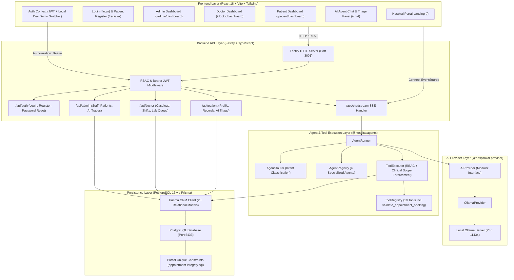

# Hospital AI Multi-Agent Application — System Architecture

## Overview

The Hospital AI Multi-Agent Application is built around a decoupled, modular architecture designed for real-world clinical operations, strong security boundaries, dynamic database-driven operations, and full multi-agent AI execution.

The system decouples the **Frontend User Interface**, **Backend Application Services**, **Role-Based Authentication & Authorization Layer**, **Agent Reasoning & Tool Execution Layer**, and the **AI Inference Provider**.

---

## Architectural Diagram

---

## Component Breakdown

### 1. Frontend Client Layer (`frontend/`)
- **Technology**: React 18, Vite 6, Tailwind CSS, TanStack Query, React Router 6, Lucide Icons.
- **Portals & Dashboards**:
  - **Homepage (`/`)**: Hospital landing portal with quick navigation for Patient Login, Doctor Login, Admin Login, Patient Registration, and bootstrap development notices.
  - **Authentication Pages (`/login`, `/register`)**: Role-specific login tabs, patient self-registration with demographic/emergency fields, and inline password change dialog.
  - **Admin Dashboard (`/admin/dashboard`)**: Full operational oversight (Doctors, Patients, Appointments, AI Agent activity, real KPI counts).
  - **Doctor Dashboard (`/doctor/dashboard`)**: Scoped daily schedule timeline, assigned patient caseload, weekly availability management, and pending lab reviews.
  - **Patient Dashboard (`/patient/dashboard`)**: Personal health portal (MRN profile, appointments, prescriptions, lab reports, support tickets) with integrated **Describe Health Issue (AI Triage)**.
  - **AI Agent Chat (`/chat`)**: Multi-agent conversational interface with token streaming, active tool badges, and transparent handoff traces.
  - **Test Lab (`/test-lab`)**: Interactive execution harness for verification scenarios TEST-001 through TEST-016.

### 2. Backend Application Layer (`backend/`)
- **Technology**: Fastify 5, TypeScript, Zod, Bcryptjs, JWT.
- **Role**:
  - Secure RESTful APIs for authentication, clinical dashboards, administrative management, and AI triage.
  - Intercepts requests with `authMiddleware` to enforce role scoping and identity boundaries before reaching the database.
  - Streams Server-Sent Events (SSE) via `/api/chat/stream`.
  - Rate limiting on public auth endpoints (10 attempts per 5 minutes per IP).

### 3. Agent & Tool Orchestration Layer (`packages/agents/`)
- **`AgentRegistry`**: Configures the 4 clinical agents with custom system prompts, role constraints, and authorized tool permissions.
- **`AgentRouter`**: Evaluates prompt intent to route requests to the most specialized agent.
- **`AgentRunner`**: Coordinates multi-turn reasoning loops, tool invocation, token streaming, and delegation loops (guarded with maximum depth and self-transfer prevention).
- **`ToolRegistry`**: Maintains schemas and Node.js execution handlers for 19 tools.
- **`ToolExecutor`**: Centralized gateway executing all tools. Validates:
  1. Tool existence.
  2. Agent permission boundaries.
  3. Caller RBAC role permissions.
  4. Patient identity ownership (`patientId`).
  5. Input schema compliance using Zod.
  6. Advisory locks and transaction boundaries for concurrency safety.
  7. Automated audit logging into `tool_executions` and `audit_logs`.

### 4. Modular AI Provider Layer (`packages/ai-provider/`)
- **`AIProvider` Interface**: Defines the contract for health checks, model discovery, standard generation, token streaming, and structured JSON output.
- **`OllamaProvider` Implementation**:
  - Communicates with local Ollama (`http://localhost:11434`) using standard fetch with AbortSignal timeout management.
  - Queries `/api/tags` to discover installed models.
  - Maps tool schemas directly into Ollama's native tool calling format.

### 5. Persistence Layer (`prisma/`)
- **PostgreSQL**: Stores relational data across 23 indexed models.
- **Prisma ORM**: Manages schema migrations, type-safe query generation, and synthetic seeding.
- **Partial Unique Constraints**: Enforces active doctor and patient slot exclusivity via raw SQL partial indexes (`prisma/appointment-integrity.sql`).
